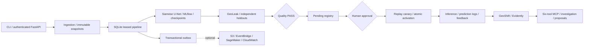

# AeroIntel

Local-first geospatial ML trust and operations platform. One building-change task,
one small Siamese U-Net, and a durable lifecycle that requires trustworthy
evaluation **and human approval** before deployment.

The local implementation includes ingestion, independent split experiments,
checkpoint recovery, MLflow, gated registry, replay canary/rollback, inference,
feedback, Evidently reports, audit history and six restricted MCP tools. Optional
AWS adapters are tested with Moto/SDK stubs. Real AWS deployment and Docker
startup remain unverified; see [engineering audit](docs/engineering-audit.md).

Final local checks: **115 tests passed**, Ruff/formatting/mypy passed, source and
wheel builds passed, Compose configuration and Terraform validated. Checkov:
58 passed, zero failed, 11 documented demo exceptions. Recorded evidence:
[verification.json](docs/results/verification.json).

## Setup, demo and checks

Requires Git, uv and Python (uv installs the project's Python 3.12). No AWS
credentials, LLM key, external dataset or GPU is needed. Run from the checkout:

```sh
python tools/dev.py setup
python tools/dev.py demo --approve-demo
python tools/dev.py check
```

The demo generates 24 small image pairs, trains three independent split
experiments, evaluates the default gates, registers a pending candidate, and
uses **your explicit `--approve-demo` flag** to approve the synthetic demo model.
It then deploys, predicts, accepts feedback, monitors reference/shifted windows
and creates a retraining proposal. Omit the flag to stop at pending approval.
The initial run generally takes a few minutes on a CPU; subsequent identical
training submissions reuse the persisted logical run.

The check command runs Ruff, formatting, mypy, all tests, package build/resource
verification, configuration validation, Compose validation when installed and
Terraform validation when available. To run only tests:

```sh
uv run --frozen --no-sync pytest
```

All dependencies are locked. PyTorch uses CPU-only wheels, including Linux CI.
The geo extra (TorchGeo/GeoPandas) is available but not required by the small
Rasterio/PyProj baseline. Full SageMaker SDK and paid LLM dependencies are not needed.

## Why geographic evaluation matters

Randomly splitting patches can put the same scene, nearby terrain or overlapping
footprints into training and testing. GeoLeak freezes groups before tiling,
compares independently trained random/scene/spatial experiments, and checks
duplicate images, source scenes and projected footprints. Spatial splits group
regions, 10 km equal-area grid blocks and buffered overlaps. At least three
independent groups are required for train/validation/test.

Missing coordinates remain null. Such datasets receive scene evaluation, an
explicit limitation and REVIEW_REQUIRED; they cannot pass the default spatial
promotion policy. GeoTIFF CRS/transforms must match both dates and the manifest.
PNG registration and externally supplied footprints remain the producer's responsibility.

## Actual synthetic result

Recorded local CPU run, 12 epochs per experiment, fixed seed 42, 256×256 padded
tiles with padded pixels excluded from metrics. The fixture has six **invented**
regions, two scenes per region and two tiles per scene. This is a lifecycle test,
not an estimate of performance on real aerial imagery or LEVIR-CD+.

| Independently trained experiment | Test IoU |
| --- | ---: |
| Random sample split | 0.996978 |
| Source-scene holdout | 0.998742 |
| Synthetic region/spatial-block holdout | 0.993441 |

The default policy passed. Reference replay produced no input drift and labeled
IoU 0.993064. Brightened inputs produced drift; the unlabeled shifted window
correctly reported null performance metrics. Full machine-readable result:
[synthetic-demo.json](docs/results/synthetic-demo.json). No real imagery benchmark
or coverage percentage is claimed.

## Architecture



All execution paths use shared packaged `specs/` contracts. Immutable model
content, approval and active deployment are separate records. Artifacts, reports,
policy content and model/dataset versions are bound together and checked again
at approval and deployment. Training success never activates a model.

Default gate targets: scene IoU ≥ 0.65/F1 ≥ 0.75, spatial IoU ≥ 0.60/F1 ≥ 0.70,
zero detected leakage, completed overlap checks. Both FAIL and REVIEW_REQUIRED
block promotion. Configure thresholds via a validated `quality_policy_path`; a
policy-content change invalidates prior evaluations/approvals.

See [architecture](docs/architecture.md), [data flow](docs/data-flow.md),
[accepted decisions](specs/adr/005-execution-and-audit-hardening.md),
[threat model](docs/threat-model.md) and [runbooks](docs/runbooks.md).

## API and MCP

```sh
python tools/dev.py serve
```

Liveness: [localhost:8000/health](http://localhost:8000/health).
API documentation: [localhost:8000/docs](http://localhost:8000/docs).
Everything except health and documentation requires a bearer credential. Create
reader/operator/approver credentials locally using `tools/create_identity.py`,
store their SHA-256 identity map in the server's `AEROINTEL_IDENTITIES` environment
variable, and keep the actual tokens outside the repository. See `.env.example`.
Server-owned role/human identity cannot be supplied in API/tool arguments.

The API handles dataset files as base64 plus a manifest; paths are confined to
server staging. Pipeline execution is synchronous and resumable. HTTP input is
limited to 32 MB; images are limited to 8 MB per API file and 16,777,216 pixels.

```sh
uv run --frozen --no-sync aerointel-mcp
```

The stdio server exposes exactly `get_pipeline_status`, `list_model_versions`,
`get_geoleak_report`, `get_drift_report`, `create_retraining_proposal` and
`request_model_promotion`. It defaults to read-only. Set `AEROINTEL_MCP_TOKEN` to a
configured operator credential for proposals. Promotion requests require prior
human approval and still do not deploy. Invalid and denied writes are audited.
An incident playbook runs with `aerointel investigate REPORT_ID`; no LLM is needed.

## Docker and AWS

```sh
docker compose up --build api
docker compose --profile tracking up --build
docker compose down
```

Compose binds to localhost and retains `./data`. The tracking profile serves the
same local MLflow database. A model trained on Windows should be viewed with
MLflow on Windows because artifact locations are absolute; container-native runs
use the shared `/app/data` mount. No container startup is claimed in this audit
because Docker Desktop's engine was unavailable.

Optional Terraform creates confined storage, event bus/Lambda/DLQ, model package
group and roles; its bounded SageMaker Processing-based pipeline is disabled by
default. There are no always-on endpoint resources in Terraform. Native endpoint
updates use SageMaker canary/rollback settings through an explicitly enabled
adapter. Read [AWS setup and cleanup](docs/aws.md) and the exact
[credential checklist](docs/credentials.md) before any cloud action.

## Data, references and limitations

LEVIR-CD+ remains a proposed real-data benchmark, subject to verified usage terms,
source-scene IDs and reliable metadata. No reference source, external weights or
dataset assets were copied. The chosen Urban Change Detection repository's license
badge was insufficient to authorize code reuse, so this model is independently
implemented. [Reference review](docs/references.md) records the inspected sources.

This is a tested single-host v1 implementation, not a claim of production readiness.
Real-data calibration, cloud staging validation, identity-provider integration,
durable external audit retention, backup/restore drills and deployment load testing
are still required before serving important production workloads.
