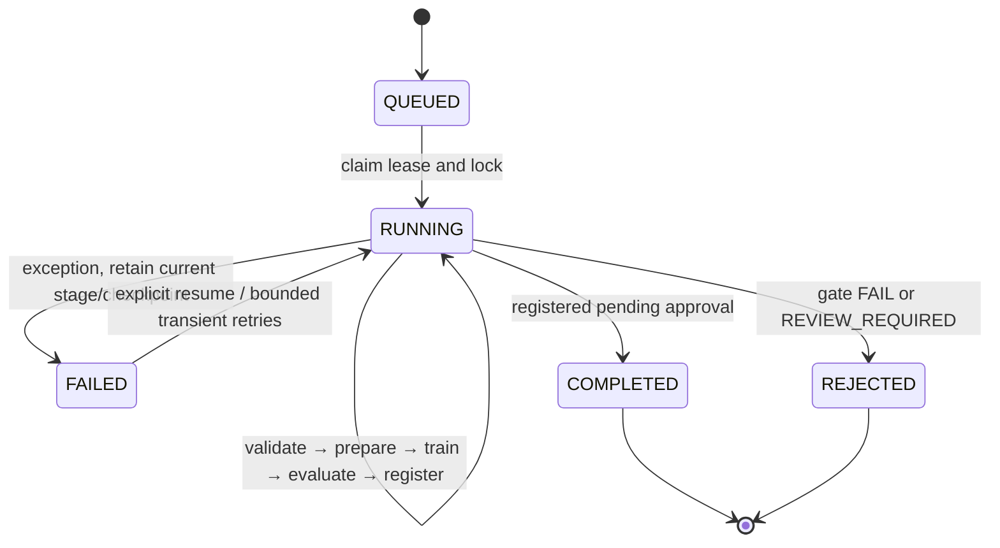
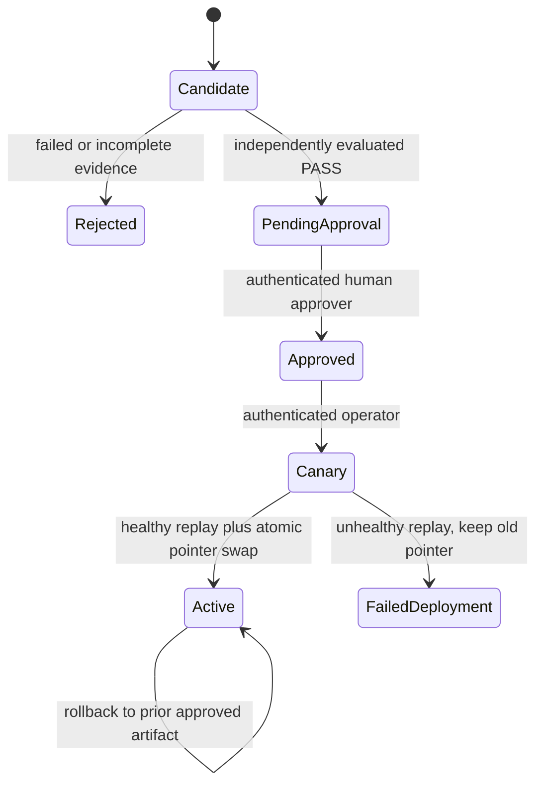

# Architecture and persistence

`app.core.platform.Platform` composes local storage, SQLite, ingestion, pipeline,
registry, deployment, production feedback and monitoring. CLI, FastAPI and MCP use
these same services. Optional cloud adapters have injected clients and mutation
guards; no core import constructs an AWS client or queries instance credentials.

`specs/` remains the single packaged wire-contract source. Application v1.0.0 and
contract v1.0.0 are independent version namespaces. `contracts/validation.py`
checks schema/format, extra fields and finite JSON values. Ingestion adds semantic
checks: hashes, binary masks, dimensions, dates, CRS, bounds and TIFF transforms.

The platform home defaults to `data/platform` or `AEROINTEL_HOME`. Configuration
may be loaded through `AEROINTEL_CONFIG`; `home` replaces the foundation's unused
separate storage/database/MLflow path settings. All immutable objects and local
MLflow state are beneath this home, enabling a coherent single-host backup.

| SQLite record | Responsibility |
| --- | --- |
| documents | Immutable datasets, evaluations, lineage, models, approvals, predictions, feedback, drift, proposals |
| runs | Logical identity, current stage/state, configuration, results, owner lease, attempts, errors |
| audit | Append-only allowed/denied history with request IDs; mutation triggers reject ordinary edits |
| outbox | Events committed with domain state, acknowledged only after publishing |
| dedup | Stable response for a scope/key/fingerprint; collisions fail |
| active/deployments | Atomic active-model pointer, prior pointer, canary outcome and history |

WAL and immediate write transactions serialize metadata mutations. A renewed run
lease plus an OS file lock prevents two workers from mutating one run's files.
Training uses a process mutex around global RNG state. Multi-host/NFS coordination
is intentionally unsupported. Do not run two hosts against this SQLite store.

## Pipeline state machine

Every transition persists stage/result and audit in one transaction. Failure before
stage completion safely reruns that stage; immutable outputs and checkpoint
identities prevent cross-version corruption. A successful stage is not inferred
from the presence of a directory. An execution with missing spatial metadata
finishes rejected with an explicit review report, never a fabricated spatial score.

## Model lifecycle

The registry rechecks report/model/dataset lineage, artifact SHA-256 and current
policy digest. An approval names the exact evaluation and artifact. Public model
state is derived from separate immutable approval and active-pointer records;
the immutable base manifest remains pending. The local canary is a replay preflight,
not live traffic. AWS update semantics are documented in ADR 005 and `docs/aws.md`.

Monitoring computes simple input features and distribution distances; Evidently
generates the inspectable report. Input shift alone is not measured accuracy loss.
Label-free windows expose null performance metrics. Only evidence-backed, idempotent
retraining proposals are created; no automated training loop is hidden behind drift.
