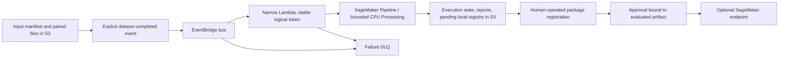

# Optional AWS deployment, costs and cleanup

No AWS resources were created, deployed or modified during this implementation.
Adapters were exercised with Moto, botocore Stubber and fake clients/credentials.
Terraform was formatted, initialized without a backend and statically validated.
An actual account plan, image push, cloud job, package approval, endpoint canary or
cleanup has not been demonstrated. Static validity is not a cloud integration pass.

## Infrastructure shape

Terraform's defaults create one protected/versioned/encrypted S3 bucket, an
EventBridge bus, disabled batch rule, narrow Lambda handler, encrypted failure
queue, log groups, roles and a SageMaker model package group. The optional pipeline
is disabled by default. Enabling it requires a reviewed ECR image pinned by digest.
One CPU Processing job runs the same local state machine, stops after at most an
hour and saves complete run state under an execution-specific S3 path. It never
approves or deploys a model. This v1 adapter deliberately does not maintain an
independent SDK Training/Processing DAG; see ADR 005.



Input manifests/files must be under `s3://BUCKET/aerointel/input/`, with image keys
relative to the manifest directory. The cloud worker checks bucket confinement,
file size, hashes, schema and usage terms. A publish failure remains retryable;
the Lambda client token is based on logical payload rather than event ID.
Output state includes local model/approval boundaries; no cloud registry approval
is inferred from processing success.

The SageMaker adapter builds `model.tar.gz` from the exact locally evaluated
artifact, uploads it through the S3 adapter, registers a package as
PendingManualApproval, and mirrors approval only after backend human-approval
checks. An update uses native 10% capacity canary and rollback alarms; first
endpoint creation has no previous fleet. Adapter deploy methods submit operations
and expose `health`; asynchronous failure handling must be observed in staging.
The inference image serves `/ping` and `/invocations` on port 8080. It expects
base64 before/after imagery, not arbitrary tensor/pickle input.

## Review and static checks

```sh
python tools/dev.py infra
uv tool run --from checkov==3.4.2 checkov --directory infrastructure/terraform --framework terraform
```

The Checkov run recorded 58 passed, zero failed and 11 explicit skips. Skips cover
demo tradeoffs: customer KMS keys, one-year logs, Lambda VPC/code signing,
cross-region replication, bucket access logging and automatic per-image events.
Encrypted failure queues and bucket-wide incomplete multipart-upload cleanup are
implemented. Each exception is explained inline and in the threat model. Resolve
these exceptions against actual production policy before production use.

## Plan and deploy — only after explicit authorization

Configure SSO and choose resource names/region from `docs/credentials.md`.
Copy `environments/demo.tfvars.example` to an untracked `.tfvars` file and review it.
Build/push reviewed images to an ECR repository beginning with the project prefix:

```sh
docker build --target worker -t YOUR_ECR_REPO:worker .
docker build --target inference -t YOUR_ECR_REPO:inference .
```

Authenticate/push using standard AWS ECR instructions in your approved account.
Pin the resulting worker image digest before enabling the pipeline. Keep dataset
terms/source metadata in its manifest; no automatic public-data download occurs.

```sh
python tools/cloud.py plan --vars infrastructure/terraform/environments/demo.tfvars
```

Review the saved plan, identities, ECR image, service quotas, execution role and
cost estimate before any apply. Only a human with explicit cloud authorization
should run:

```sh
python tools/cloud.py apply --confirm-paid-aws
```

The helper does not infer approval from a successful local test. Model package
registration and endpoint activation are explicit adapter operations using the
standard credential chain and additional reviewed IAM permissions. Their tests
document expected SDK contracts; this repo does not claim an unattended one-click
production cloud deployment.

## Cost estimate model and risks

Local tests/demo make no cloud calls. Cloud compute, endpoint uptime, storage and
requests can be billable; check the current regional
[SageMaker pricing](https://aws.amazon.com/sagemaker/ai/pricing/) and
[S3 pricing](https://aws.amazon.com/s3/pricing/) before approval. Do not assume
Free Tier/credit eligibility. No fixed currency estimate is claimed without an
account, reviewed instance choices and measured job durations.

For the default bounded job, reserve up to **one ml.m5.large Processing
instance-hour plus 20 GB of attached volume for that duration**, then add S3
GB-months/versions/requests, ECR image storage, Lambda/EventBridge/SQS usage,
CloudWatch logs/alarms/metrics and X-Ray samples. This is a resource estimate,
not a pricing quote. Endpoint cost is hourly fleet capacity × runtime; canaries
temporarily require both old and new fleets. Endpoint uptime has no automatic
one-hour cap in the adapter, so schedule teardown. Processing timeout is not an
account-wide spending cap, and versioned objects persist after jobs finish.

## Cleanup and verification

Inventory endpoints first. Use exact project endpoint names and explicit approval:

```sh
uv run --no-sync python tools/cloud.py inventory
uv run --no-sync python tools/cloud.py delete-endpoint --endpoint aerointel-NAME --confirm-paid-aws
python tools/cloud.py destroy-plan --vars infrastructure/terraform/environments/demo.tfvars
python tools/cloud.py apply --confirm-paid-aws
```

The delete helper waits for endpoint deletion, but unused model/config/package
versions, ECR images and retained S3 versions need deliberate inventory/cleanup.
Back up evidence first. The bucket intentionally has `force_destroy=false`;
Terraform refuses deletion of a nonempty bucket. It does not silently erase model
lineage. Disable event rules/stop processing jobs before teardown, inspect DLQ,
delete approved data versions only when authorized, remove the bucket, then verify
SageMaker endpoints/jobs/configs/models, ECR, logs, queues/events and Terraform state.
No actual cleanup result is claimed without an authorized cloud demonstration.
