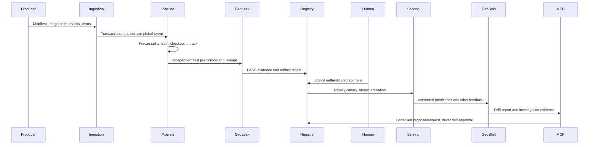

# Data flow and reproducibility

1. A source manifest and files arrive through CLI or authenticated API. Verify
   usage terms, checksums, scene IDs, metadata and images. Snapshot objects by hash.
   Commit a versioned dataset and completed event only after all validation succeeds.
2. Dataset identity plus training configuration, manifest hash and quality-policy
   digest identifies one logical run. Duplicate ingestion events reuse that run.
3. Freeze random, scene and optional spatial assignments. Group before tiling;
   scene/region/grid/overlap boundaries cannot straddle folds. Save assignment hash.
4. Train each experiment independently on CPU with seed, optimizer state,
   epoch-local ordering, validation-selected checkpoints and MLflow run lineage.
   Fixed decision threshold is configured before test evaluation; no test tuning.
5. Evaluate test masks with padded pixels excluded. Record IoU/F1/precision/recall,
   region metrics, leakage, limitations and PASS/FAIL/REVIEW_REQUIRED. Save provenance
   separately without changing the existing evaluation-report schema.
6. Passing candidates register pending approval. Authenticated human approval
   binds artifact/evaluation/policy. Operator deployment reruns integrity/approval
   checks, performs replay health checks, then swaps the pointer atomically.
7. Inference validates/tile-processes paired imagery, stores masks/probabilities,
   model version, feature summary, uncertainty and request identity. GeoJSON is
   produced in EPSG:4326 only with valid metadata. Entropy is a review heuristic,
   not calibrated predictive confidence.
8. Feedback joins immutable binary ground truth to prediction IDs. GeoShift compares
   version-specific windows against reference data, emits Evidently JSON/HTML and a
   contract drift report, and records missing labels explicitly.
9. The six MCP tools read reports or create controlled proposals. Backend policy,
   identity, evidence, idempotency and audit enforce writes. Proposals never train
   or deploy automatically.

Events share event UUID, timestamp, actor, correlation, type and schema version.
The transactional outbox gives at-least-once delivery; handlers deduplicate logical
work, not just event IDs. A publish failure leaves the event unacknowledged.

Checkpoints support exact CPU recovery at completed epoch boundaries. An interrupted
partial epoch reruns deterministically from the previous checkpoint. MLflow may
contain repeated metric entries after a crash between logging and acknowledgement;
authoritative experiment history/checkpoints and model registration remain unique.
